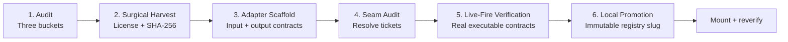

# bolt-mcp

**Take the capability. Keep your architecture. Prove the seam.**

`bolt-mcp` is a local MCP server and CLI for harvesting a small, licensed slice of upstream code, wrapping it behind a canonical contract, and proving that boundary before reuse. A SQLite ledger records the workflow; a local inspector makes its evidence readable.

**v0.2.0 · MIT · Node.js 24.15+ · No model calls, API keys, or hosted backend**

## Why surgical bolt-in beats whole-repo bloat and vibe-coded reinvention

Whole-repository imports bring unrelated frameworks, application assumptions, and maintenance obligations. Reinventing an existing capability loses the benefit of tested upstream work. Surgical integration keeps explicit source paths and their licenses, records content hashes, and gives the host one adapter boundary to depend on.

Bolt makes that boundary reviewable: what was copied, what must remain untouched, which seams failed, which command actually ran, and whether the promoted files still match the verified component. It does not guess how an arbitrary vendor API should map to your domain.

## Six stages, evidence at every gate



```text
HOST: canonical models and orchestration
                   │
                   ▼
         adapter.ts / adapter.mjs / adapter.py
         ┌───────────────────────────────────┐
         │ validateInput → executeVendor     │
         │ timeout + structured errors       │
         │ normalizeOutput → canonical value │
         └─────────────────┬─────────────────┘
                           ▼
                     vendor/ slice

Host → vendor: forbidden. Slot A → Slot B: forbidden.
Host → adapter A + adapter B: the coordination boundary.
```

The ledger moves through `PENDING → HARVESTED → WIRED → POLISHED → VERIFIED`. Promotion is a registry action, not another slot status. Failed audits revoke stale verification. A successful audit preserves `VERIFIED` only when component contents still match its verification fingerprint.

## Install from source

Requirements: Node.js **24.15 or newer**, npm, and Git. Python **3.10+** is needed when harvesting/auditing Python source or running Python adapters. SQLite comes from Node's built-in `node:sqlite`; no native npm build or Python packages are needed.

```sh
git clone https://github.com/meridian-alpha/bolt-mcp.git && cd bolt-mcp && npm ci --ignore-scripts && npm link
```

This is the source-release installation route; npm publication is a separate release step. For an existing checkout, run `npm ci --ignore-scripts && npm link`. Run `bolt-mcp --help` to confirm the CLI is available.

### Connect your coding client with one command

After installation, run the appropriate command **from the host project**:

| Client | Command |
| --- | --- |
| Claude Code | `claude mcp add --transport stdio bolt-mcp -- bolt-mcp serve --project "$PWD"` |
| Codex CLI | `codex mcp add bolt-mcp -- bolt-mcp serve --project "$PWD"` |
| Cursor | `bolt-mcp install-client cursor` |
| Windsurf | `bolt-mcp install-client windsurf` |

Cursor configuration is merged into `.cursor/mcp.json`. Windsurf configuration is merged into `~/.codeium/windsurf/mcp_config.json`. Both installers preserve unrelated entries and refuse to replace an existing `bolt-mcp` entry. Their runtime-generated paths use the installed executable and current project. Restart or refresh the client's MCP connection after setup.

Claude and Codex commands use their native MCP registration syntax. See [Claude Code MCP](https://code.claude.com/docs/en/mcp) and [Cursor MCP configuration](https://docs.cursor.com/context/model-context-protocol). The server follows the [official SDK stdio transport](https://ts.sdk.modelcontextprotocol.io/server).

Other clients can launch `bolt-mcp serve --project /path/to/project` over stdio. Stdout is reserved for MCP; diagnostics go to stderr. The prompt is registered as `bolt-and-build`, typically surfaced as `/bolt-and-build` or a client-namespaced slash command.

## A complete local example

Run this from the `bolt-mcp` checkout after installation. It uses the bundled local fixture; no remote repository is needed.

```sh
mkdir -p /tmp/bolt-example-host
bolt-mcp init --project /tmp/bolt-example-host --json '{
  "projectName": "Example host",
  "customBrains": ["Canonical domain model"],
  "plumbingSlots": [{"slotId":"math","capability":"Double a number"}],
  "bannedPatterns": ["legacyWire("]
}'
bolt-mcp harvest --project /tmp/bolt-example-host --json "{\"slotId\":\"math\",\"sourceRepoOrPath\":\"$PWD/test/fixtures/upstream\",\"targetPaths\":[\"slice.mjs\",\"helper.mjs\"]}"
bolt-mcp scaffold --project /tmp/bolt-example-host --json '{
  "slotId":"math", "language":"mjs", "entryPoint":"slice.mjs",
  "inputSchema": {
    "type":"object", "properties":{"value":{"type":"number"}},
    "required":["value"], "examples":[{"value":3},{"value":-2}]
  },
  "outputSchema": {
    "type":"object", "properties":{"result":{"type":"number"}},
    "required":["result"], "examples":[{"result":6},{"result":-4}]
  }
}'
bolt-mcp audit --project /tmp/bolt-example-host --json '{"slotId":"math"}'
bolt-mcp verify --project /tmp/bolt-example-host --json '{"slotId":"math"}'
bolt-mcp promote --project /tmp/bolt-example-host --json '{"slotId":"math","slug":"double-v1","tags":["math"],"description":"Canonical numeric adapter"}'
bolt-mcp serve-ui --project /tmp/bolt-example-host
```

Open **http://localhost:5390**. `bolt-mcp --ui` also starts the inspector; `bolt-mcp serve --ui` runs both MCP and the inspector. Use `--port` to change the inspector port. It is read-only, binds only to loopback, and rejects foreign Host and Origin headers.

Consume the adapter from the host:

```js
import { executeVendor } from './src/bolted/math/adapter.mjs';
const result = await executeVendor({ value: 3 });
// { ok: true, value: { result: 6 } }
// The vendor's internal field is removed by normalizeOutput.
```

Every failure is `{ ok: false, error: { code, message } }`, with `INPUT_INVALID`, `TIMEOUT`, `VENDOR_ERROR`, or `OUTPUT_INVALID`. Each invocation starts an isolated process; there is no shared vendor singleton. This provides enforceable timeouts at the cost of process startup overhead.

### Search and mount

Declare the destination slot during its project audit, then:

```sh
bolt-mcp registry --json '{"query":"math"}'
bolt-mcp registry --project /path/to/second-project --json '{"query":"double-v1","mountSlotId":"numbers"}'
```

Search terms must all match the slug, tags, or description. Mount requires one result or an exact slug. It verifies the stored component fingerprint, refuses an occupied destination, and reruns seams and the generated contract in the new project. Failure leaves the mounted component inspectable with an unverified ledger state.

## MCP tools and CLI reference

All tools accept an optional `projectPath`; it defaults to the server's configured project. CLI commands accept the same camelCase arguments through `--json FILE`, `--json '{...}'`, or `--json -` (stdin). `--project PATH` takes precedence. Results are JSON; failed audits, tests, mounts, and invalid input exit nonzero.

| MCP tool | CLI | Required arguments | Optional arguments |
| --- | --- | --- | --- |
| `bolt_init_ledger` | `init` | `projectName` | `customBrains`, `plumbingSlots`, `bannedPatterns` |
| `bolt_surgical_harvest` | `harvest` | `slotId`, `sourceRepoOrPath`, `targetPaths` | `stripPatterns` |
| `bolt_scaffold_adapter` | `scaffold` | `slotId`, `inputSchema`, `outputSchema` | `language`, `entryPoint`, `exportName`, `timeoutMs` |
| `bolt_audit_seams` | `audit` | `slotId` | — |
| `bolt_verify_slot` | `verify` | `slotId` | `testCommand`, `timeoutMs`, `allowedEnvKeys`, `sandboxMode` |
| `bolt_registry_promote` | `promote` | `slotId`, `slug` | `tags`, `description` |
| `bolt_registry_search_mount` | `registry` | — | `query`, `mountSlotId` |

`plumbingSlots` accepts identifier strings or `{ slotId, capability }` objects. Slot IDs and registry slugs use 1–80 letters, digits, underscores, or hyphens and start with a letter or digit. `customBrains` and `bannedPatterns` are nonempty strings. Banned patterns are **case-sensitive literal substrings**, not regular expressions; preserved-brain descriptions remain human review obligations.

Additional CLI commands: `serve` (default), `serve-ui`, `install-client cursor|windsurf`, `--help`, and `--version`.

| MCP surface | Contents |
| --- | --- |
| `bolt://ledger/current` | Most recently used project audit, slots, seam tickets, security notices, and last 50 verification runs |
| `bolt://registry/catalog` | Local registry index |
| `bolt-and-build` prompt | Six-stage workflow; optional `capability` argument |

Library exports are the seven engine functions: `initLedger`, `surgicalHarvest`, `scaffoldAdapter`, `auditSeams`, `verifySlot`, `promoteToRegistry`, and `searchAndMountRegistry`.

## Contracts and harvesting details

- **Contracts:** supply paired root-level `examples` in both schemas. Each pair is a real input and expected normalized output; generated tests check equality, plus rejection of a wrong input type. Add domain-specific edge cases and assertions to the generated test before promotion.
- **Schema subset:** explicit `type` of `object`, `array`, `string`, `number`, `integer`, `boolean`, or `null`; `properties`, `required`, `items`, `enum`, `minimum`, `maximum`, `minLength`, `maxLength`, `minItems`, `maxItems`, `title`, `description`, and `examples`. Objects reject undeclared input properties; outputs are projected recursively onto declared properties. `additionalProperties:false` is supported and is the default behavior. Unsupported keywords, including `$ref`, `pattern`, and unions, are rejected rather than ignored. This is intentionally a documented subset, not a full JSON Schema implementation.
- **Entry binding:** `entryPoint` is relative to `vendor/`. It can be inferred when exactly one explicit target is a source module; otherwise supply it. JS/TS defaults to a `default` export, Python to `execute`; change `exportName` for another callable. The callable receives one JSON-compatible payload. `language:"js"` produces `adapter.mjs` to keep module semantics consistent; TypeScript runs using Node's native type stripping.
- **Vendor dependencies:** external packages are not installed automatically. Keep their manifests/license notices where needed and install reviewed dependencies in the host environment. Package-global state, native extensions, build steps, aliases, and non-callable APIs can require a hand-edited adapter. Scaffold failure is never replaced with an identity stub.
- **Sources:** local directories and `https://`, `http://`, `ssh://`, `git@…`, and `file://` Git sources. Remote clones use depth 1, blob filtering, and sparse checkout. Remote HEAD is recorded; local source can be uncommitted or dirty, so its file hashes are the authoritative snapshot. No Git hooks are run.
- **Selection:** paths remain relative to the source root. Only requested files/directories and root license files are copied. `stripPatterns` are file exclusion globs, not text replacements. Missing relative sibling imports produce actionable warnings; explicitly add their paths to the harvest. Relative dependencies absent from the final vendor slice block seam approval. Reharvesting an occupied slot is refused; use a new slot to preserve the existing implementation.
- **Licensing:** root `LICENSE*`, `LICENCE*`, and `COPYING*` files are retained even if a strip glob matches them. MIT and Apache-2.0 text is recognized; other licenses are marked `SEE LICENSE`, absent licenses `UNKNOWN`. A label is not a compatibility decision. Preserve additional notices and review upstream reuse obligations.

## Determinism and verification boundaries

There are no probabilistic decisions or AI calls in the engine. Given the same inputs and files, validation and static findings follow fixed rules and ordering. Timestamps, execution duration, upstream HEAD, operating-system behavior, and arbitrary vendor/test behavior are inherently variable. “Deterministic” describes the workflow gates, not bit-identical timestamps or a guarantee that arbitrary code is correct.

The seam auditor parses JS/TS with the TypeScript compiler syntax API and Python with the standard-library `ast` parser. It detects static imports, side-effect imports, dynamic literal imports, barrel exports, CommonJS `require`, TypeScript import-equals/type imports, Python `import`/`from`, `__import__`, and `importlib.import_module` (including common loader aliases and literal relative packages). Import-looking comments and string contents are not imports. Python source is parsed in an isolated interpreter without executing inspected modules.

Relative imports, `src/`, `@/`, `~/`, Python project/source roots, and explicit `tsconfig.json`/`jsconfig.json` path mappings are resolved. JSONC and local relative `extends` chains are supported. Syntax errors, computed module names, unsupported config inheritance, and cycles become blocking findings. Vue/Svelte/HTML script blocks and Astro frontmatter are analyzed with their original line numbers. This is source syntax analysis, not arbitrary runtime execution: metaprogramming, loader monkey-patching, custom build plugins, or unknown dynamically assigned loader aliases still require review. Only byte-identical shipped runtime bridges are exempted from the computed-import finding; renaming a file to `adapter.runtime.mjs` cannot bypass the check.

Checks 1–4 cover direct vendor imports, cross-slot coupling, unfinished boundaries, and complete vendor hash inventories. Banned audit patterns and unresolved relative vendor dependencies add findings. **Check 5** emits a separate `security_notices` array for `eval(`, `new Function(`, `child_process`, `subprocess.Popen`, `os.environ`, and `process.env`. Each notice contains `severity`, `rule`, `file`, `line`, and `message`. Notices are advisory lexical matches, may include comments, and do not block `POLISHED`; they are stored in SQLite and displayed in `.bolt/BOLT_LEDGER.md` and the inspector. A notice indicates a capability to review, not proof of malicious behavior. Existing v0.1 ledgers gain the notice table without losing their rules or history.

Files under `.git`, `.bolt`, `node_modules`, `.venv`, `__pycache__`, `dist`, `build`, and `coverage` are excluded from host source analysis. Symlinks and special files are refused. Vendor inventory and security-notice checks include all harvested files, including normally excluded names.

### Subprocess isolation

Verification first audits, then runs the generated contract or explicitly supplied shell command with a default 30-second timeout and a combined 1 MiB output limit. Adapter calls default to 5 seconds; both timeouts accept 1–600000 ms. Nonzero exits, signals, timeouts, excessive logs, changed component files, or newly failed seams prevent `VERIFIED`. Exit code, duration, stdout, stderr, and timeout/truncation flags are recorded in SQLite. Generated Node contracts run directly with Node's built-in test API; this avoids an unnecessary nested test-runner process.

Every contract subprocess and every generated JS/TS/Python vendor worker receives an allowlisted environment: `PATH`, `HOME`, `USERPROFILE`, `TMPDIR`, and `TEMP` if present, plus forced `NODE_ENV=test` and `PYTHONDONTWRITEBYTECODE=1`. Other parent variables—including API keys, `NODE_OPTIONS`, and `PYTHONPATH`—are absent unless explicitly named in `allowedEnvKeys`. Node's internal `NODE_TEST_CONTEXT` is always removed to prevent silent recursive-test skipping. Environment values are never included in execution-policy arguments or audit notices. Only allow application variables you intend to expose; an explicit allowlist entry can deliberately grant a secret or an execution-control variable.

```sh
bolt-mcp verify --project /path/to/project --json '{"slotId":"math","sandboxMode":"node-permission","allowedEnvKeys":["APP_PUBLIC_SETTING"]}'
```

| Mode | Behavior |
| --- | --- |
| `clean-env` (default) | Scrub environment and enforce process-group cleanup. Supports Node, Python, and custom shell test commands. No filesystem restriction. |
| `node-permission` | Additionally apply Node's `--permission` (or supported experimental equivalent), granting filesystem reads/writes only within `projectPath` and `os.tmpdir()`. Requires a generated Node contract; Python and custom shell commands are rejected rather than silently downgraded. |

The permission flags are applied to both the contract process and generated vendor workers. Trusted contract code receives child-process permission so it can start the adapter worker; vendor workers receive no child-process, worker-thread, native-addon, or WASI permission. Use contract tests you trust: granting child creation to a test harness means the harness itself must not deliberately launch an unrestricted process. The package still requires Node 24.15+; permission-flag detection is based on the active runtime.

On POSIX, contract runners own detached process groups. Nested generated workers remain in that group, so an outer timeout also terminates their ordinary descendants; standalone adapter calls own a worker group. Cleanup occurs on normal completion, timeout, and log overflow. Standalone workers also watch caller disconnection or death and terminate their own group. Windows cleanup is limited to the direct process; Linux/WSL is the tested target. Deliberately escaped process groups require OS-level containment.

Standalone generated adapters also scrub their worker environments. Call `executeVendor(payload, { allowedEnvKeys: ['APP_PUBLIC_SETTING'], sandboxMode: 'node-permission' })` for JS/TS to select the same worker policy; Python accepts `allowedEnvKeys` and rejects Node permission mode. A verifier-selected Node permission policy cannot be weakened by an adapter call's options. The project root is derived from the portable `src/bolted/<slot>/` location or the verifier's explicit execution context.

Node's permission model is a defense against accidental resource access, **not a sandbox for hostile code**. It does not guarantee network isolation on every supported Node release. Files inside the allowed project/temp roots remain accessible, including any secrets stored there. For untrusted code, use OS/container isolation as well. See [Node's permission security model](https://github.com/nodejs/node/blob/main/doc/api/permissions.md). Custom commands remain trusted assertions: `true` only proves that `true` exited successfully.

Existing generated adapters are not silently rewritten. Review and migrate their runtime helpers to the v0.2 templates, or scaffold a fresh declared slot, then rerun audit and verification. An older or edited dynamic runtime bridge will fail the new exact-template audit until updated.

## Storage, concurrency, and recovery

```text
host-project/
├── .bolt/
│   ├── ledger.db          # SQLite WAL, rules, slots, tickets, test logs
│   └── BOLT_LEDGER.md     # regenerated human-readable view
└── src/bolted/<slot>/
    ├── vendor/            # preserved upstream-relative paths + licenses
    ├── provenance.json    # source, commit, timestamp, license, file hashes
    ├── adapter.mjs        # or .ts / .py
    ├── adapter.runtime.mjs # or .py; standalone boundary support
    ├── adapter.isolation.mjs # Node environment/permission support
    └── contract.test.mjs  # or .py
```

The global local registry is `path.join(os.homedir(), '.bolt-mcp', 'registry')`; `BOLT_REGISTRY_DIR` overrides it for isolated tests or another local catalog. Each immutable `<slug>/` contains the complete portable component; `index.json` records metadata and its fingerprint. Promotion rechecks both the fingerprint and host seams. The registry is local evidence, not a signed supply-chain attestation.

SQLite uses WAL, foreign keys, and a busy timeout. Filesystem operations are serialized per project and registry by `operation.lock`; index/Markdown replacements are atomic. Another concurrent mutation fails explicitly. After a killed process, inspect its recorded PID and remove a stale lock only once that operation has stopped. A crash can leave a staging directory or completed files before a ledger update; preserve those files for inspection, then recover under a new slot or restore the project backup. There is no destructive reset command. Initializing an existing ledger refuses to replace its rules or slots.

Add `.bolt/` to a host project's ignore rules when logs and source locations should stay local. Review provenance and any harvested source before publishing a host repository; local source paths are recorded at runtime. Bolt itself ships generic examples and excludes runtime databases, credentials, and dependencies from its release package.

## Develop and verify

```sh
npm ci --ignore-scripts
npm run check
npm audit --omit=dev
npm pack --dry-run
```

The `node --test` integration suite includes a raw newline-delimited JSON-RPC stdio handshake (without an MCP client SDK), all seven tools through actual MCP stdio, local and Git sparse harvesting, JavaScript/TypeScript/Python contracts, every seam category, tampering, errors, timeouts, output limits, registry promotion/remounting, CLI behavior, configuration merging, inspector access controls, environment scrubbing, filesystem permission denials, nested process cleanup, polyglot parsing, and security-notice persistence. Fixtures and registries are temporary. GitHub Actions runs the suite across supported Node versions with Python available.

Contributions should include a failing test for changed workflow behavior and preserve the public-source hygiene check. No code is pushed or published by the application. Internal handoff notes live in ignored `.bolt/PROJECT_STATE.md` and are not included in the public repository or package.

## License

MIT for bolt-mcp. Harvested components retain their upstream licenses.
